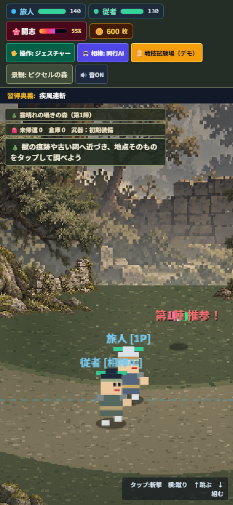
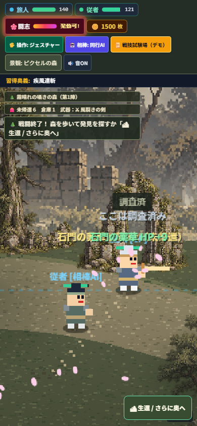

# Pixel forest: playable iteration and review

Starting main: `acf41ae979f7d21fde5bfdf1b621e19d06e4d98e`.

The flat repeated forest becomes a layered pixel environment. The handoff background is reused only for distant scenery. A new transparent tree/ruin atlas, cached grass/earth texture, stone causeway derived from actual collision heights, atmospheric distance and foot-depth-sorted discovery props create the near scene. Uniform canvas scaling fixes the stretched actors on portrait phones. The scene can switch back to its previous drawing; failed art loading also uses that drawing.

The new discovery is **tracks → sealed stone gate → return with fangs → forge sword → revisit and open the gate**. The gate yields two materials and up to 45 HP once per expedition. Materials remain unbanked until a living return and are lost on defeat. The sword's existing combat effect gains an exploration use. This is one small local scene, not a completed RPG economy or a new region.

## Observed checks

- `npm test`: **1,400 passed, zero failed/skipped**.
- `node scripts/verify-gemini-feel-phone.cjs`: existing 360/390px combat, gestures, shop, companion, isolated save restore and shrine touch checks passed after adapting camera expectations to the corrected portrait viewport.
- `npm run playtest:pixel-forest`: **passed at 360/390/430px**. The new driver uses real Chromium touch/keyboard inputs and a read-only state probe; it never sets actor HP/positions, discovery flags or saves.
- Final scripted run: first fight 9.6s, minimum player HP 111/140; tracks brought carried materials from 3 to 4; uncrafted gate denied rewards; return banked 4; smith used 3; second fight 6.6s, minimum HP 131/140; rediscovered tracks and opened gate; second return banked a total of 7 remaining materials. Reload preserved the sword and banked 7 with zero carried materials. Main location-game demo save remained byte-identical.
- Portrait X/Y canvas scales agree within 0.003; no horizontal overflow; actual touch joystick movement and gesture attack passed. No page runtime errors.
- `git diff --check`: passed.

The existing image-placement test needed `fileURLToPath` instead of URL `.pathname` to read fixtures on Windows/Japanese paths. This fixes verification portability, not gameplay.

## Visual judgment and remaining limits

Built-in image generation made one atlas after a successful Visual Director non-character package. The PNG has valid transparency and decodes correctly, but did not follow the requested equal-cell layout; source rectangles were calibrated to the actual objects. It remains a candidate. Original source bytes, full prompt and review results are preserved; no layered Pixelorama/Aseprite source or paid MCP generation is claimed.

Live Jev Vision (`jev-1.14.0`) rejected the source candidate: verdict `reject_candidate` confidence .89; strongest issue `style` (.92 confidence); artifacts probability .76; quality 1.56/4. Its global rubric retains sumi-e-on-washi. The user explicitly requested pixel evolution, so style disagreement alone is not a reason to silently revert the requested experiment. Other reported defects remain review findings, not waived acceptance.

The separate actual-phone screenshot review returned raw `revise` (.57 confidence), crop as primary issue, composed `needs_review`. These are advisory findings; neither image nor global Canon is approved. The remaining visual mismatch between detailed scenery and existing simple actors is visible. The stone causeway also retains deliberately simple procedural masonry. A true 3D HD-2D renderer, fully matched actor animation, physical-phone FPS, outdoor GPS, and human 15-minute voluntary replay are **unverified/not delivered** by this PR.

Machine evidence: [browser run](assets/candidates/pixel-forest-review/browser-report.json), [asset judgment](assets/candidates/pixel-forest-review/asset-jev.json), [phone judgment](assets/candidates/pixel-forest-review/phone-jev.json). Tool decisions and source limitations: [pixel forest experiment](visual/pixel-forest-experiment.md).

Keep this as a Draft PR for visual/play review. Do not interpret automated reachability as proof that the game is fun or promote candidate art to Canon automatically.
