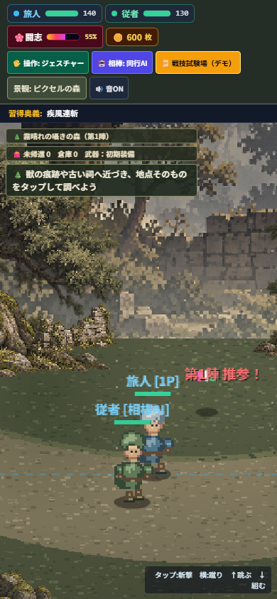
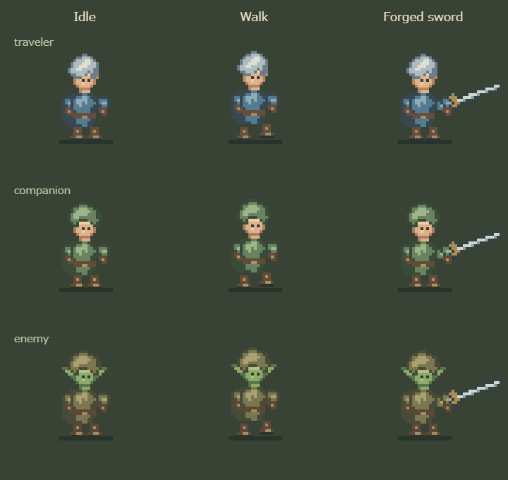

# Modular pixel actors

The user's 2026-10-23 request extends the action forest's pixel direction to characters and reusable object parts. This scoped implementation uses hand-authored Canvas pixel patterns in `src/pixel-actors.js`; it generates no replacement raster assets and does not adopt an image as an Approved Anchor.

The shared rig composes boots, coat/armor, rear arm, face, hair or hood, front arm and equipment. Traveler, companion and enemies reuse the same parts with separate muted palettes. Silver hair identifies the traveler; the companion wears a green hood; goblin ears identify enemies. Cached transparent canvases hold each part/palette combination. Animation only moves the cached parts, keeping walking, running and attack frames inexpensive.

Facing, jump height, knockdown rotation, hit immunity, names and health bars remain driven by the existing renderer. Forged swords and temporary pickups are independent equipment layers. The classic art toggle retains the previous actor rendering. World objects continue to share the existing six-region forest atlas.

To edit a part, change its string rows in `parts`; a dot means transparent, and other symbols resolve through `schemes`. Add palette variants without duplicating frames. All character drawing is presentation only and never changes fighter state, collision, attack reach or saves.

Verification is recorded in the PR. Browser screenshots and deterministic checks establish rendering and playable reachability; physical-phone performance and human visual preference remain separate observations.

## Verified in this iteration

- `npm test`: 1,402 passed, zero failed or skipped.
- `npm run playtest:pixel-forest`: 360/390/430px touch and uniform aspect; real-input fight, discovery, return, forge, revisit, gate reward and saved reload passed.
- `node --check src/pixel-actors.js` and `git diff --check`: passed.
- Actual 390px screenshot inspected; actor detail and labels above the head are visible.
- Jev advisory completion: `jev_status=ok`, `done` (confidence 1), model `jev-1.14.0`, request `req_01a168355f5970d5aed8439cf8a38df9`. This evaluates reviewable engineering completion, not human art approval or permission to merge/deploy.

## Human feedback revision

The user rejected the first actor design as unpleasant. That verdict supersedes the earlier engineering completion judgment as visual feedback. The revision lowers the proportions, uses short boots and compact sleeves, replaces the large outlined face with two small eyes, and simplifies the clothing silhouette. Explicit neck and thrust-sleeve parts keep the head and attacking arm connected. Skin has its own palette symbols; arms remain clothed/gloved. Weapon metal uses a shared neutral palette across roles.

`node scripts/preview-pixel-actors.cjs` renders the actual runtime parts at integer zoom for checking idle, walk and forged-sword poses together. The screenshot is a review artifact, not an Approved Anchor or proof of user acceptance.

